<p align="center">
  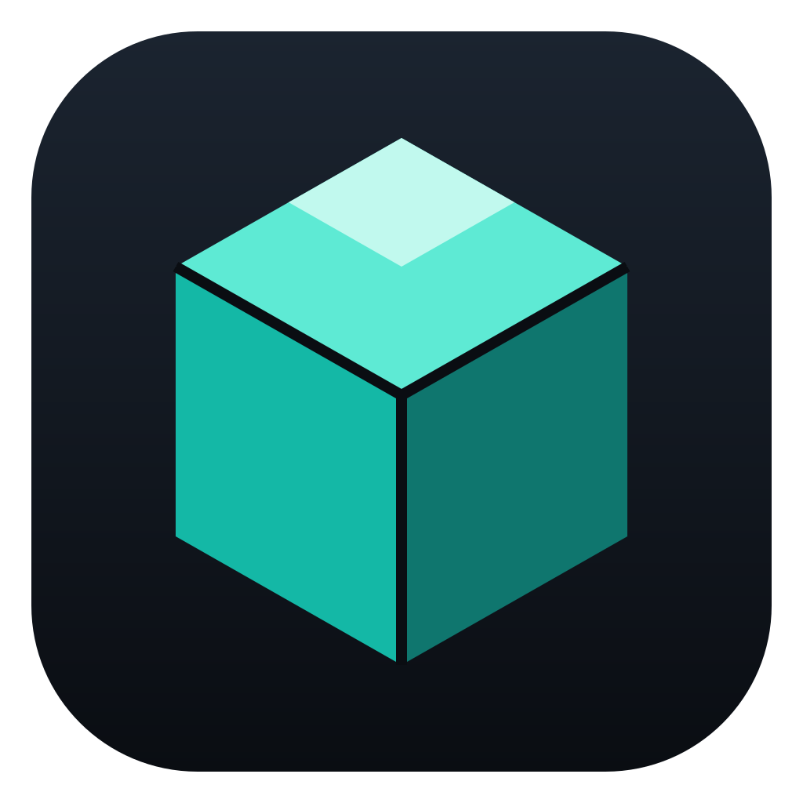
</p>

<h1 align="center">Kubism</h1>

<p align="center">
  <b>Kub</b>ernetes <b>I</b>nterface for <b>S</b>upervising <b>M</b>ulti-clusters<br />
  <i>Inspect. Steer. Monitor.</i>
</p>

<p align="center">
  <a href="https://github.com/pgourlain/kubism/actions/workflows/ci.yml"></a>
  <a href="https://github.com/pgourlain/kubism/releases/latest"></a>
  
  
  <a href="LICENSE"></a>
</p>

A cross-platform desktop app to explore and operate **one or several Kubernetes clusters at the same time**, in the spirit of [Lens](https://k8slens.dev/) and [Freelens](https://github.com/freelensapp/freelens). Built with Avalonia 12 on .NET 10. No `kubectl` needed: Kubism talks to the API server itself.

<p align="center">
  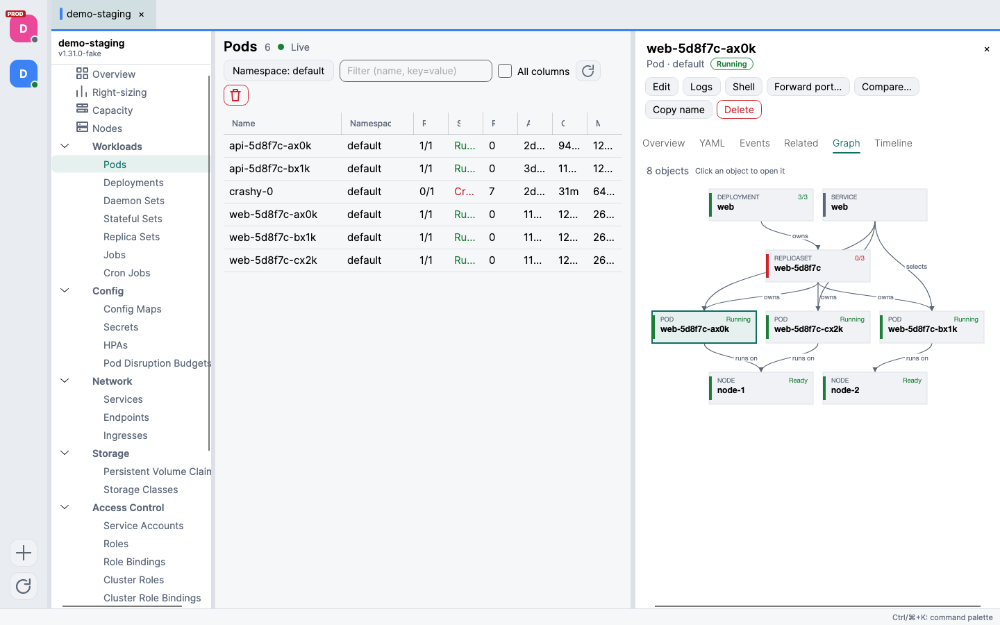
</p>

> Try it in one minute, without a cluster: `Kubism --demo` starts a fake API server with three sample clusters (staging, production and a drifted dev).

## Highlights

- **Several clusters side by side**: each connected cluster is its own tab, with a colour and a safety mode; split view, global search, hotbar with `⌘/Ctrl+1…9`.
- **Everything live**: lists follow the cluster through watches (no refresh button), including CRDs with their own printer columns.
- **See how things connect**: a relation graph, a cross-cluster diff and a search by image, all built from the objects already on screen.
- **Safe by design**: *production* clusters ask for the resource name before any destructive action, *read-only* clusters refuse every change, Secret values are never shown unless you reveal one key.
- **Right-sizing**: requests and limits next to what containers really use over days, with ready-to-paste corrections.
- **AI-ready**: `Kubism --mcp` is an MCP server (read-only by default) for Claude and other assistants.

## Features

### Explore

| | |
|---|---|
| **Cluster catalog** | Built from `KUBECONFIG` (merged), `~/.kube/config` and extra files or folders; edits to the files show up within a second. Label, colour, icon, tags and safety mode are stored by the app, never written into your kubeconfig. |
| **Live resource lists** | Virtualized grid, namespace multi-select, text and `key=value` label filter, sortable columns, bulk selection. The columns are the ones `kubectl get` shows, computed by the API server. |
| **Details panel** | Overview per kind (containers, probes, conditions, taints…), YAML with syntax highlighting, events, related objects, and the graph. |
| **Command palette** | `⌘/Ctrl+K` jumps to any kind (`po`, `deploy`, `svc`…), namespace or cluster. |
| **Overview** | Nodes, pods by phase, CPU and memory against capacity and requests, problem pods and recent warnings. |

<p align="center">
  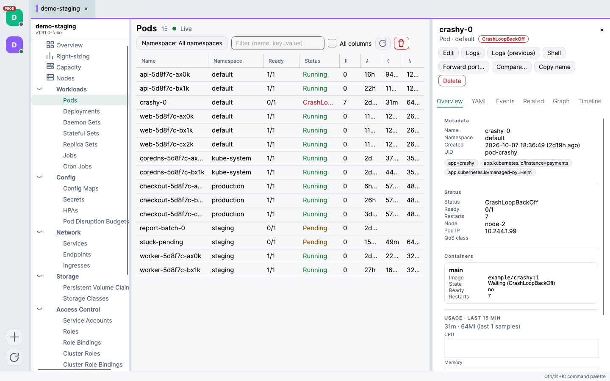
</p>

### Understand how things connect

- **Relation graph.** Open the *Graph* tab on any object to see its neighbourhood, top to bottom: Ingress → Service → Pod ← ReplicaSet ← Deployment, plus the ConfigMaps, Secrets, volume claims, service accounts and nodes it uses, HPAs scaling it, and the **Helm release** that rendered it, at the top with its revision and status (recognised from the annotations Helm puts on everything it installs). The *Graph* tab of the Helm page does the reverse: a release at the top, then everything it manages and what runs below. Boxes show the live status (green, amber, red); click one to open that object. Shared config is shown but never expanded, so one popular ConfigMap does not drown the picture.
- **Timeline.** The *Timeline* tab of a workload or pod puts everything on one time axis, newest first: events (those of its replica sets and pods too), rollouts (one per revision, with the image), pod creations, OOM kills and crashes with the exit code, and failing conditions. *Problems only* keeps what went wrong, so "what changed before it broke" reads top to bottom.
- **Compare clusters.** Pick another connected cluster (or another namespace), a kind, and see what exists on one side only and what differs, as a line diff of the manifests. Server-generated fields are ignored, so only real drift remains. Secret values are never shown: a key is masked, and marked when it differs. Also available from any object with **Compare…**.
- **Global search.** One query across every connected cluster, grouped by cluster: `checkout` (name), `app=web` (label), `image:nginx:1.25` (a container image: *who still runs this tag?*), `ns:staging`, `kind:deploy`. Tokens combine.

<p align="center">
  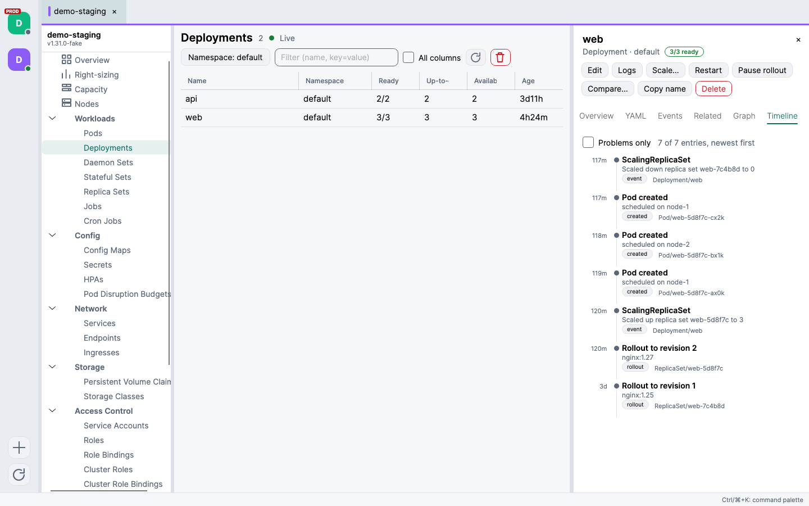
</p>

<p align="center">
  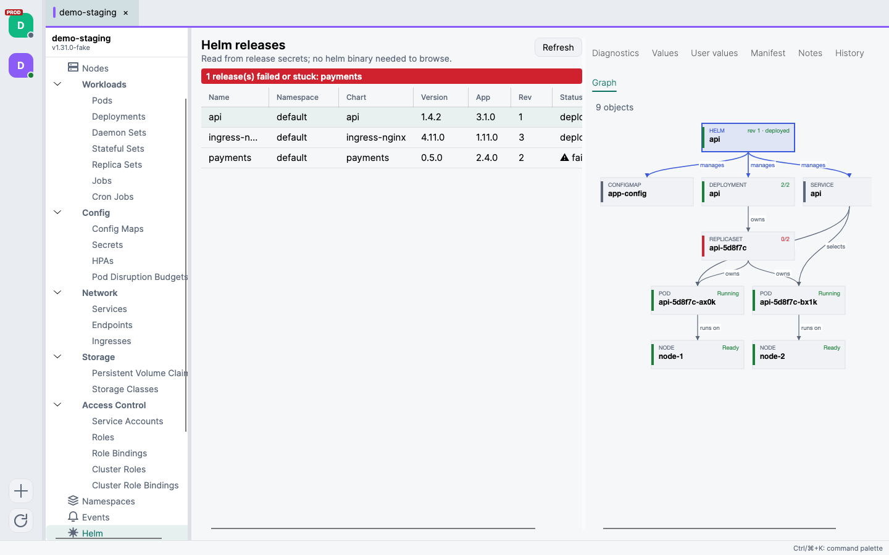
</p>

<p align="center">
  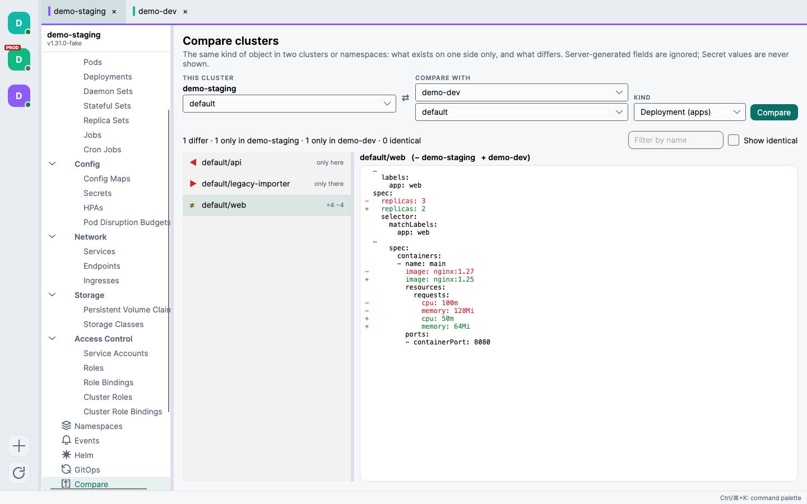
</p>

<p align="center">
  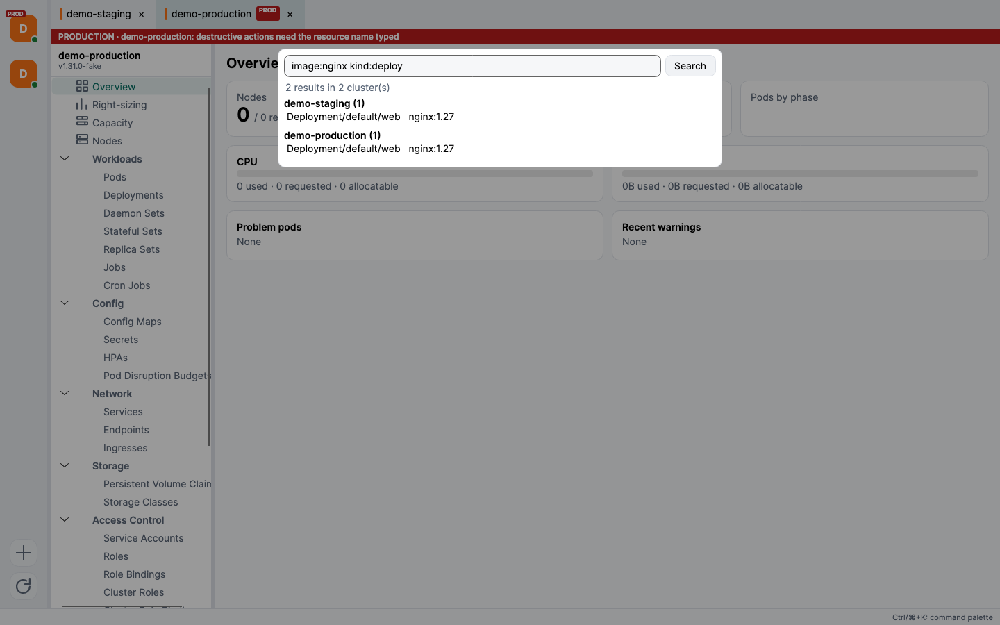
</p>

### Security

A read-only *Security* page for the selected namespaces, with three tabs:

- **Workloads**: an audit of every workload's pod spec: privileged containers, host network/PID/IPC, host paths (the container runtime socket is flagged high), root, privilege escalation, dangerous capabilities (`SYS_ADMIN`, `NET_ADMIN`, `ALL`…), images without a version, the default service account. Controllers are audited through their template, so one problem is reported once. *High only* cuts the noise; *Open object* jumps to the workload.
- **Access (RBAC)**: risky grants (cluster-admin to non-system subjects, wildcard roles, `bind`/`escalate`/`impersonate`, cluster-wide Secret reads, `pods/exec`, anonymous or *every authenticated user* bindings), and **who can do what**: type a ServiceAccount, user or group and see every rule it ends up with, with the binding it comes from, including through its groups.
- **Certificates**: expiry of TLS secrets and cert-manager `Certificate` objects, soonest first (expired, within 7 days, within 30 days). Only the public certificate is read, never the key, and nothing of the secret is kept.

<p align="center">
  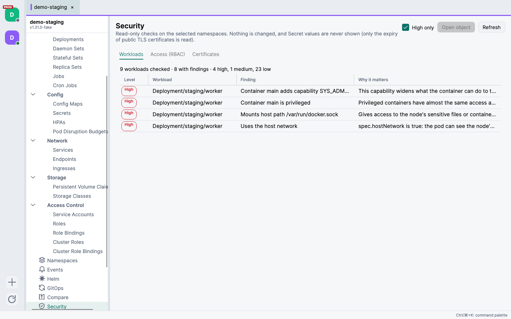
</p>

<p align="center">
  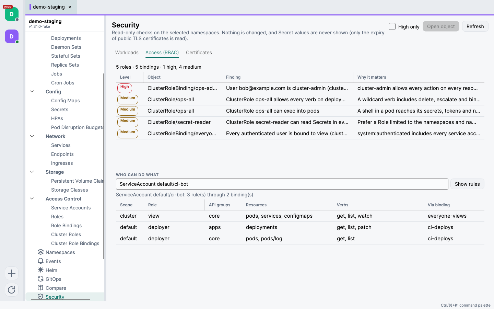
</p>

<p align="center">
  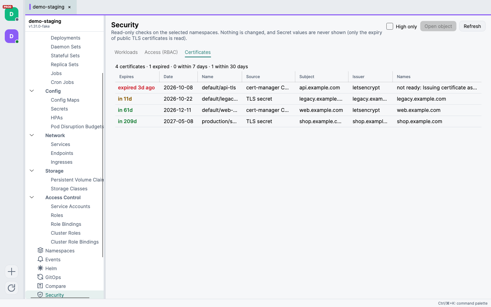
</p>

### GitOps: Argo CD and Flux

Where Argo CD or Flux is installed, a *GitOps* page lists Argo CD Applications and Flux Kustomizations, HelmReleases and sources together: sync, health, revision, source, destination and when it last changed, with what **needs attention** (degraded, out of sync, failed to reconcile) first. Select one to see its message and what it manages, with out-of-sync objects on top (Flux shows the inventory of a Kustomization). The page refreshes itself every few seconds.

Actions go through the same safety checks as everything else: **Sync**, **Sync and prune** (production asks for the name), **Refresh** and **Hard refresh** for Argo CD; **Reconcile** and **Suspend/Resume** for Flux. This is also why Kubism refuses to apply right-sizing changes to a workload these tools manage: copy the snippet into the repository instead.

<p align="center">
  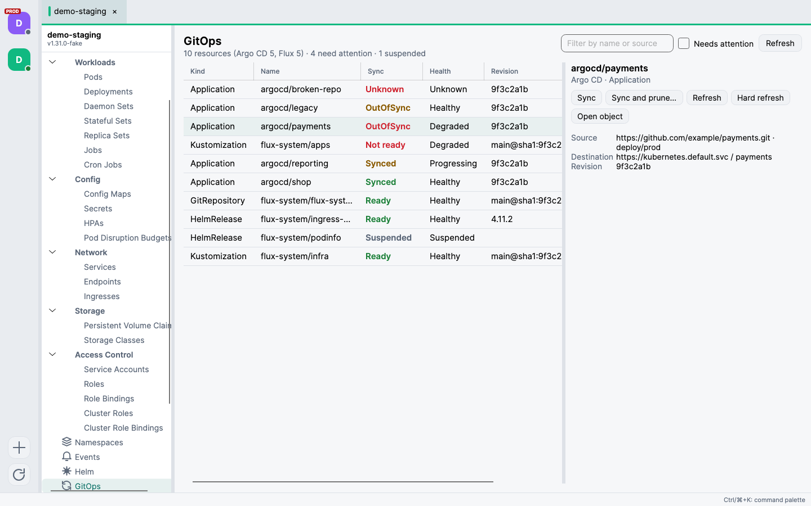
</p>

### Operate

- **Safe actions**: edit YAML with conflict handling (a `409` shows a diff, never overwrites), create from YAML (multi-document, server-side apply), delete (single and bulk), scale, rollout restart and pause, cordon, drain (respects PodDisruptionBudgets, with progress and cancel), trigger or suspend a CronJob.
- **Logs**: follow, search with regex, wrap, timestamps, pause, JSON pretty-printing, previous (crashed) container, and merged logs for a whole workload.
- **Shell** into a container (WebSocket exec with TTY and resize) and **port-forward** to pods or services, with the list of active forwards.
- **RBAC aware**: buttons you cannot use are disabled with the reason, instead of failing on click.
- **Activity log**: everything the app did on the cluster in this session, exportable. Secret values are never recorded.

<p align="center">
  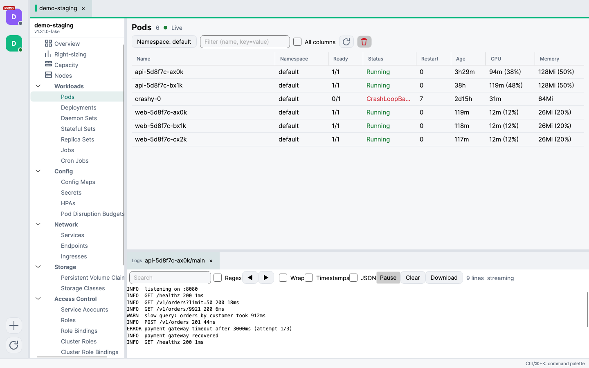
</p>

### Safety first

Nothing writes to a cluster except through one class that checks the cluster's safety mode, records the action and raises an event. A cluster marked *production* (set automatically for contexts named `prod`, `prd` or `production`) shows a red banner and asks you to type the resource name before deleting, draining or scaling to zero; a *read-only* cluster refuses every change, whether it comes from the UI or the MCP server.

<p align="center">
  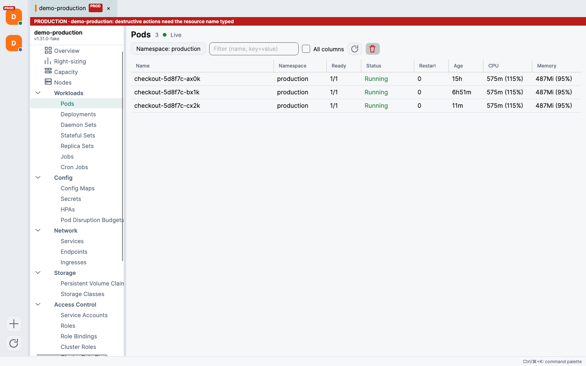
</p>

### Capacity and cost

A *Capacity* page, from what pods **request** (what the scheduler counts):

- **Nodes**: requested against allocatable CPU, memory and pod slots for each node, the free room and how scattered it is, and the **pods that cannot be placed** with a verdict: *fits on node X, so look at taints or affinity*, *fragmented* (enough in total, but no single node has it), *too big for any node*, *cluster is full*, or *no node accepts pods*, next to what the scheduler said.
- **Cost**: what each namespace, or any label (team, app…), requests, priced per month with the per-vCPU-hour and per-GiB-hour prices you set (saved with the cluster), and how much of the nodes' capacity is idle. Without prices it shows shares.
- **What if**: applies the right-sizing recommendations to the requests, per namespace, and tells how much it saves (or costs: an under-provisioned workload asks for more) and how many nodes the new total would fit on.

<p align="center">
  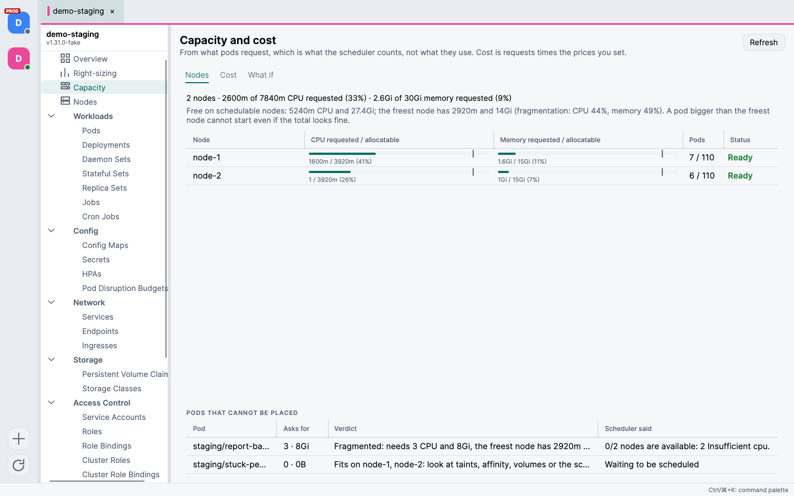
</p>

<p align="center">
  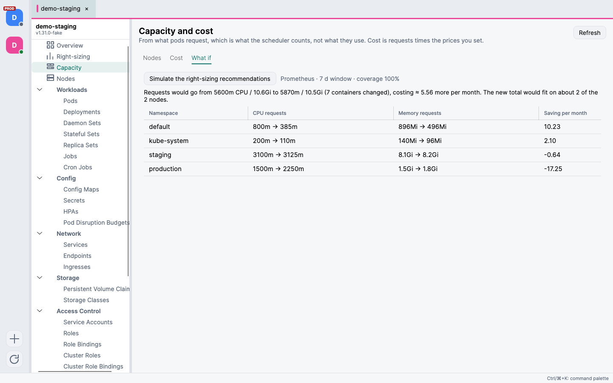
</p>

### Right-sizing: requests and limits against real usage

For every container of every workload, Kubism puts requests and limits next to what it really uses over days (default 7, up to 30), flags what is over- or under-provisioned (no request, CPU throttling, OOM kills, memory limit too tight) and computes the corrected `resources` block. History comes from, in order of preference: Prometheus (cAdvisor), Azure Monitor managed Prometheus (AKS), the VPA recommender, or local sampling of metrics-server (no infrastructure needed).

You can apply the change (a rollout is announced, production rules apply), or copy it as plain YAML, Helm values or a Kustomize patch. Workloads managed by Argo CD, Flux or Helm refuse a direct apply ("will be reverted: copy the snippet instead"). Export a CSV or Markdown report, see waste per namespace and per cluster.

<p align="center">
  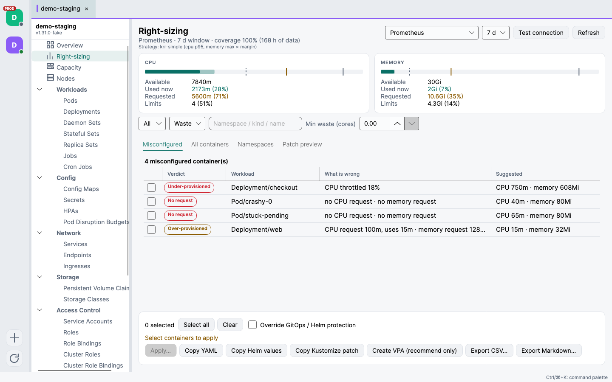
</p>

### Helm and custom resources

Releases are read from the cluster's `helm.sh/release.v1` secrets, with no `helm` binary needed: status, chart, revisions, values (user-supplied or computed), manifest, notes and history. Failed or stuck releases are flagged and diagnosed on the spot (warning events, crashing pods and their logs). Rollback and uninstall use the `helm` CLI when it is on your `PATH`. The CRD browser lists definitions, schemas and instances.

<p align="center">
  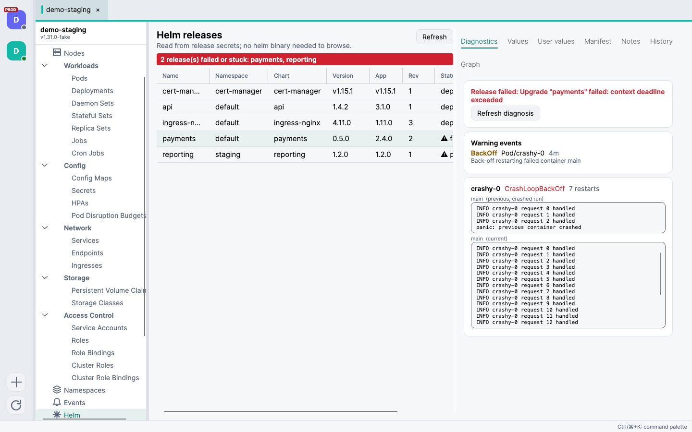
</p>

### Multi-cluster

<p align="center">
  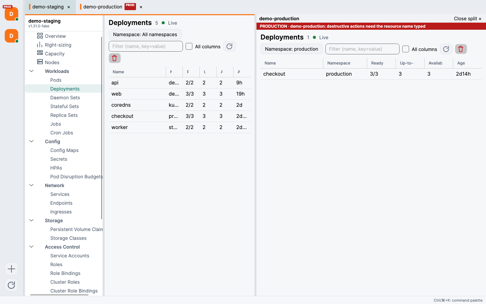
</p>

Connect as many clusters as you like. A budget of informers per cluster keeps many connected clusters cheap, and everything a view started is cancelled when you close it or disconnect.

### Light, dark, English, French

<p align="center">
  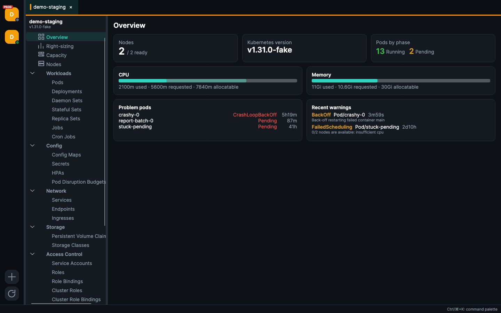
</p>

The theme follows the OS (or your choice). The interface is available in English and French, with keyboard navigation throughout.

### For AI assistants: the MCP server

`Kubism --mcp` exposes your clusters to an assistant over stdio: list clusters and kinds, list and get resources (Secret values redacted), events, bounded logs, `top`, the right-sizing report and a `describe`. Write tools (`apply`, `delete`, `scale`, `rollout_restart`) are off unless started with `--allow-writes`, and production clusters additionally need `--allow-production`. Setup for Claude Code and Claude Desktop: [docs/mcp.md](docs/mcp.md).

## Install

Download the package for your system from the [latest release](https://github.com/pgourlain/kubism/releases/latest). The builds are not signed yet.

| System | Package | How |
|---|---|---|
| **Windows** | `Kubism-<version>-win-x64.zip` | Unzip and run `Kubism.exe`. SmartScreen may warn: *More info → Run anyway*. |
| **macOS** | `Kubism-<version>-osx-arm64.dmg` (Apple Silicon) or `osx-x64.dmg` (Intel) | Open the dmg and drag `Kubism.app` to Applications. The app is not notarized, so macOS blocks the first launch: open *System Settings › Privacy & Security* and click **Open Anyway**, or run `xattr -dr com.apple.quarantine /Applications/Kubism.app`. |
| **Linux** | `Kubism-<version>-linux-x64.tar.gz` | Extract it, run `opt/kubism/Kubism`. Copy `usr/share/applications/kubism.desktop` to `~/.local/share/applications/` for a menu entry. |
| **Arch / Omarchy** | `kubism-bin-<version>-1-x86_64.pkg.tar.zst` | `sudo pacman -U kubism-bin-<version>-1-x86_64.pkg.tar.zst` |

For AKS, EKS or GKE, the exec plugin named in your kubeconfig (`kubelogin`, `aws`, `gke-gcloud-auth-plugin`) must be installed. Kubism finds it even when launched from the Dock or the menu, by resolving the `PATH` of your login shell.

## Build and run from source

Requires the .NET 10 SDK.

```bash
dotnet build Kubism.slnx
dotnet test --project Kubism.Core.Tests     # also: Kube.Tests, Desktop.Tests, Mcp.Tests
dotnet run --project Kubism.Desktop -- --demo   # fake API server + Prometheus, no cluster needed
dotnet run --project Kubism.Desktop             # real clusters from your kubeconfig
packaging/package.sh osx-arm64 0.1.0            # self-contained package into artifacts/
```

The screenshots above are rendered by the headless UI tests against the fake API server. To refresh them:

```bash
KUBISM_DOCS_SCREENSHOTS=$PWD/docs/screenshots dotnet test --project Kubism.Desktop.Tests --filter-class "*DocsScreenshotTests"
```

## Documentation

- [CLAUDE.md](CLAUDE.md): design, rules and architecture (the guide for contributors and coding agents).
- [tasks.md](tasks.md): roadmap and status, phase by phase.
- [docs/architecture.md](docs/architecture.md) · [docs/mcp.md](docs/mcp.md) · [docs/adr/](docs/adr/)

## Principles

Nothing writes to a cluster except through `ClusterActions`. Secret values are never shown, logged or sent anywhere unless you reveal one key, and the MCP server never returns them. The UI thread never waits for the network. Kubism does not need `kubectl`, and never writes into your kubeconfig files.

## License

[MIT](LICENSE). Third-party notices: [THIRD-PARTY-NOTICES.txt](THIRD-PARTY-NOTICES.txt).
